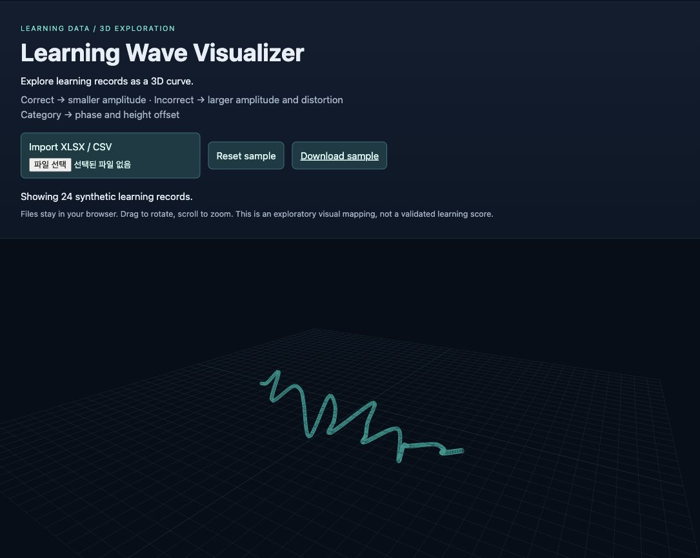

# Learning Wave Visualizer

**Explore learning records as an interactive 3D curve.**  
React · Three.js · React Three Fiber · Vite · SheetJS

학습 항목의 유형과 정오답을 3차원 곡선으로 표현하는 브라우저 기반 시각화 프로젝트입니다.



## Why this project

A table of learning records can be difficult to inspect at a glance. This prototype explores an explicit visual mapping from category and correctness to curve shape. It is an exploratory interface, not a validated assessment of learning ability.

## Features

- Open with 24 synthetic records; reset the sample at any time.
- Import XLSX, XLS or CSV from the first worksheet, entirely in the browser.
- Normalize boolean values and reject invalid records before rendering.
- Map correctness to amplitude and distortion, and category to phase/height parameters.
- Rotate and zoom the curve, automatically fitting it into view.

## Quick start

Use **Node.js 24 or newer** (`.nvmrc` selects 24). The lint toolchain requires a supported Node release.

```bash
npm ci
npm run dev
```

Open the local URL printed by Vite. Use **Download sample** for the input template.

```bash
npm test
npm run lint
npm run build
npm run preview
```

## Input format

```csv
problem_id,category,section,status
1,Practice,Unit 1,true
2,Intermediate,Unit 1,false
3,Exam,Unit 2,true
```

- `status`: required; `true`, `false`, `1` or `0` (boolean strings are case insensitive).
- `category`: `Practice`, `Intermediate`, `Outsource` or `Exam`; defaults to `Practice` when omitted.
- `problem_id` and `section`: optional metadata; not displayed on the curve in this version.
- Use 2–500 records and a file no larger than 2 MiB. These limits keep the prototype responsive.

## Design

`src/data.js` handles normalization and coordinate mapping. `src/App.jsx` handles import, React state and Three.js rendering. Geometry is regenerated when data changes and disposed after replacement. Imported file content is not sent to a backend; the app has no server-side storage.

## Validation

Validated with Node.js 24.22.2 after a clean `npm ci` installation. Three automated checks cover boolean normalization, input validation and visual mapping invariants. Lint and production build passed during preparation. The built page was also opened in a browser and its synthetic curve was visually checked.

## Limitations

- The mapping is illustrative and has not been scientifically validated.
- It does not calculate a learning score, show per-record tooltips or preserve imports after a reload.
- WebGL is required. The bundled spreadsheet and 3D libraries produce a relatively large initial download (a build size warning remains).
- This release is a local demo; no hosted deployment is included.

## Portfolio summary

Implemented a React/Three.js prototype that normalizes tabular learning data, maps records into a deterministic 3D curve and offers local spreadsheet import with interactive navigation.

## Status and provenance

Portfolio prototype, prepared from a local project. See [PROVENANCE.md](PROVENANCE.md) for release preparation and attribution notes. Original private datasets, environments and unverified media are excluded. Dependency licenses apply separately. A project license has not yet been selected.
